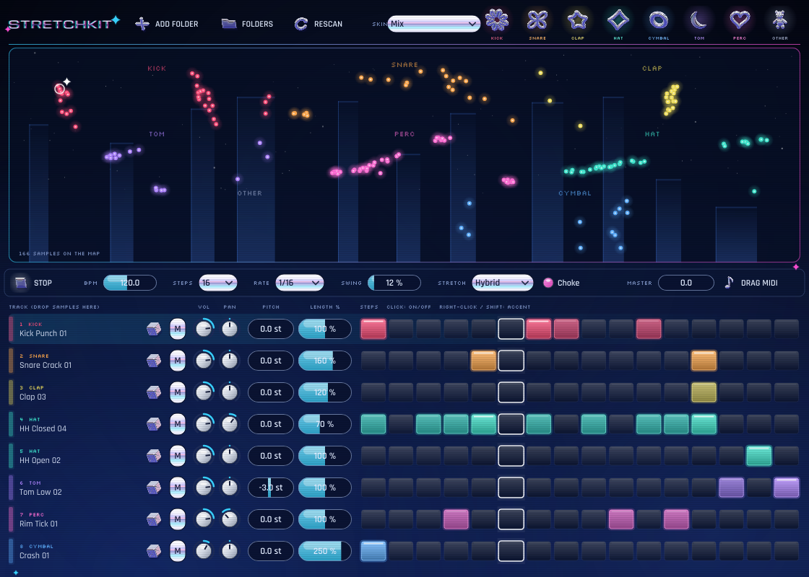

# StretchKit

드럼 샘플을 **소리 특성별로 자동 분류해 지도에 펼쳐 보여주고**, 각 샘플의 길이를 **원본 대비 %로 타임스트레치**하며, **스텝 시퀀서**로 바로 비트를 찍을 수 있는 무료 오픈소스 드럼 플러그인입니다.



- 포맷: **VST3 / AU / Standalone** (macOS Universal, Windows x64)
- VST2는 지원하지 않습니다. Steinberg가 2018년부터 신규 VST2 라이선스를 발급하지 않기 때문입니다.
- XO(XLN Audio)의 "사운드 지도" 개념에서 영감을 받았지만, 코드·디자인·이름은 전부 독자적으로 구현했습니다.

---

## 기능

### 1. 샘플 지도 (자동 분류)
- **Add Folder**로 드럼 샘플 폴더를 추가하면 하위 폴더까지 전부 스캔합니다 (wav / aif / aiff / flac / ogg, 10초 이하 원샷만).
- 분류 순서: ① 파일·폴더 이름(`kick`, `BD_01`, `Snares/…` 등) → ② 이름에 단서가 없으면 소리 자체를 분석(저역 비율, 스펙트럼 중심, 노이즈 정도, 감쇠 시간, 클랩의 다중 타격 등).
- 카테고리: Kick / Snare / Clap / Hat / Cymbal / Tom / Perc / Other. 같은 카테고리 안에서는 **비슷한 소리끼리 가깝게** 배치됩니다(특징 벡터 PCA).
- 스캔 결과는 캐시되어 다음 실행 때 바로 뜨고, **Rescan**은 새로 추가·변경된 파일만 다시 분석합니다.

| 지도 조작 | 동작 |
|---|---|
| 점 클릭 | 미리 듣기 |
| 점을 트랙으로 드래그 | 그 트랙에 로드 |
| 점 더블클릭 | 선택된 트랙에 로드 |
| Alt 누른 채 마우스 이동 | 지나가는 소리 연속 미리 듣기 |
| 휠 / 빈 곳 드래그 | 확대·축소 / 이동 (빈 곳 더블클릭 = 원위치) |
| 상단 카테고리 버튼 | 해당 카테고리 표시/숨김 |

### 2. 드럼용 타임스트레치 (트랙별 LENGTH %)
LENGTH는 **원본 샘플 길이 기준**입니다. 25% ~ 400%, 더블클릭하면 100%.

| Stretch 모드 | 설명 |
|---|---|
| **Hybrid** (기본) | 타격 어택은 원본 그대로 두고, 그 뒤 꼬리만 Rubber Band R3로 늘이거나 줄임. 드럼에 가장 자연스러움 |
| Smooth | 샘플 전체를 Rubber Band R3로 처리 |
| Tape | 테이프 속도 변화처럼 길이와 음정이 함께 변함 |

스트레치는 샘플을 불러오거나 값을 바꿀 때 **백그라운드에서 미리 계산**해 두기 때문에 레이턴시가 없고, 재생 중 CPU 부담도 거의 없습니다. PITCH(±24반음)는 클래식 샘플러 방식이며, LENGTH %는 피치를 바꿔도 원본 길이 기준으로 유지됩니다.

### 3. 스텝 시퀀서
- 8트랙 × 8/16/32스텝, 1/8 · 1/16 · 1/32 · 1/16T, 스윙
- 클릭 = 켜기/끄기, 우클릭 또는 Shift+클릭 = 액센트, 드래그로 연속 입력
- DAW 재생 시 DAW 템포·위치에 샘플 단위로 정확히 동기화. DAW가 멈춰 있을 땐 **Play** 버튼으로 내부 클럭 재생
- **Rnd**: 지도에서 지금 소리와 가까운(비슷한) 샘플로 교체
- **Choke**: 같은 트랙의 이전 소리를 짧게 페이드아웃 (끄면 소리가 겹쳐 울림)
- **Drag MIDI**: 현재 패턴을 MIDI 클립으로 DAW에 끌어다 놓기
- MIDI 입력: C1(36)~G1(43)이 트랙 1~8을 연주

### 4. 스킨 (시안 5종)
`docs/` 폴더에 실제 렌더링한 화면이 있습니다. 상단의 **SKIN** 메뉴에서 언제든 바꿀 수 있고, 마지막으로 고른 스킨이 새 인스턴스의 기본값이 됩니다(처음 기본값은 Mix). 프로젝트마다 고른 스킨도 함께 저장됩니다.

| 스킨 | 느낌 |
|---|---|
| PS2 Night | 남색·검정, 안개, 유리 타워, 메뉴 불빛 |
| Y2K Chrome | 펄 실버·아이스블루·핫핑크, 크롬 캡슐 버튼, 젤리 스텝 |
| Digicore | 검정+네온, 픽셀 폰트, 글리치, 스캔라인, 옛날 윈도우 창 |
| Mix | PS2 바탕 + Y2K 크롬 버튼 + 디지코어 반짝이·글리치 |
| Liquid Chrome | 블루-바이올렛 + 유리 빛줄기, 3D 리퀴드 크롬 아이콘 버튼 |

Y2K Chrome, Mix, Liquid Chrome은 버튼에 3D 리퀴드 크롬 아이콘을 씁니다(`docs/chrome_icons.png`).
아이콘은 `tools/chrome_icons.py`(직접 만든 작은 3D 렌더러)로 생성하며, 모양이나 반사를 바꾼 뒤 다시 렌더링할 수 있습니다.
```bash
pip install numpy scipy pillow
python3 tools/chrome_icons.py Resources/icons 128
```

---

## 다운로드 / 빌드

### 방법 A: GitHub에서 자동 빌드 (추천, 맥이 없어도 됨)
1. GitHub 저장소: https://github.com/edwina9195/stretchkit
2. 올리면 **Actions** 탭에서 맥·윈도우 빌드가 자동으로 돌아갑니다 (15~25분).
3. 완료된 실행 화면 아래 **Artifacts**에서 `StretchKit-macOS`, `StretchKit-Windows`를 받습니다.
4. 정식 배포: `v0.1.0` 같은 태그를 푸시하면 **Releases** 페이지에 zip이 자동으로 첨부됩니다.

### 방법 B: 직접 빌드
필요: CMake 3.22+, Git, (맥) Xcode, (윈도우) Visual Studio 2022. JUCE와 Rubber Band는 자동으로 내려받습니다.

```bash
cmake -B build -DCMAKE_BUILD_TYPE=Release
cmake --build build --config Release --parallel
```
결과물: `build/StretchKit_artefacts/Release/`

맥 Universal(Apple Silicon + Intel): 첫 줄에 `"-DCMAKE_OSX_ARCHITECTURES=arm64;x86_64"` 추가

---

## 설치

| | 위치 |
|---|---|
| macOS VST3 | `~/Library/Audio/Plug-Ins/VST3/StretchKit.vst3` |
| macOS AU | `~/Library/Audio/Plug-Ins/Components/StretchKit.component` |
| Windows VST3 | `C:\Program Files\Common Files\VST3\StretchKit.vst3` |

**macOS 보안 경고**: 애플 공증(유료 개발자 계정)을 받지 않은 빌드라, 인터넷에서 받은 파일은 차단될 수 있습니다. 설치 후 터미널에서 한 번 실행하세요.
```bash
xattr -dr com.apple.quarantine ~/Library/Audio/Plug-Ins/VST3/StretchKit.vst3
xattr -dr com.apple.quarantine ~/Library/Audio/Plug-Ins/Components/StretchKit.component
```
AU가 Logic에 안 보이면 `killall -9 AudioComponentRegistrar` 후 DAW를 재시작하세요.

**Windows**: 서명이 없어 SmartScreen 경고가 뜰 수 있습니다 (추가 정보 → 실행).

DAW에서는 **악기(Instrument)** 플러그인으로 MIDI 트랙에 올리면 됩니다.

---

## 이름·제작자 바꾸기
`CMakeLists.txt`의 `juce_add_plugin` 부분에서 바꿉니다.
- `COMPANY_NAME`, `PRODUCT_NAME`, `BUNDLE_ID`
- `PLUGIN_MANUFACTURER_CODE` (4글자, 대문자 1개 이상), `PLUGIN_CODE` (4글자) — 다른 플러그인과 겹치지 않게
- 한 번 배포한 뒤 코드를 바꾸면 DAW가 다른 플러그인으로 인식하니 배포 전에 정하세요.

---

## 라이선스
이 프로젝트의 코드는 **GNU GPL v3** 로 배포합니다(JUCE는 AGPLv3 조건으로 함께 사용). 바이너리를 배포할 때는 소스 코드(이 저장소 링크)를 함께 제공해야 합니다.

- [JUCE 8](https://juce.com) — AGPLv3 조건으로 사용
- [Rubber Band Library](https://breakfastquay.com/rubberband/) v4 — GPLv2 or later (Particular Programs Ltd.)
- VST는 Steinberg Media Technologies GmbH의 상표입니다.

자세한 고지는 `LICENSE.md` 참고.

---

## 소스 구조
```
Source/
  dsp/DrumStretcher        하이브리드 타임스트레치 (어택 보존 + Rubber Band R3)
  library/FeatureExtractor 오디오 특징 추출 + 분류 규칙
  library/SampleLibrary    폴더 스캔, 캐시, 지도 배치(PCA), 비슷한 소리 찾기
  PluginProcessor          시퀀서, 보이스 재생, 백그라운드 렌더, 상태 저장
  PluginEditor, ui/        지도, 트랙 행, 스텝 그리드
Tests/
  Tests.cpp                스트레치·분류 오프라인 테스트 (CI에서 실행)
  HostTest.cpp             DAW 없이 프로세서·에디터 전체 동작 테스트
```
테스트 빌드: `-DSTRETCHKIT_BUILD_TESTS=ON` (DSP), `-DSTRETCHKIT_BUILD_HOST_TEST=ON` (전체)
